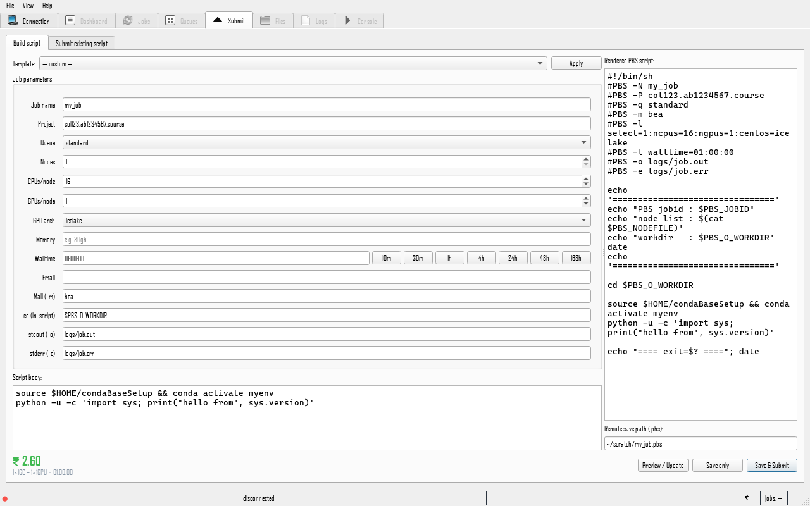

# HPC-IITD GUI

A complete desktop GUI for using the **IITD High Performance Computing** cluster (`hpc.iitd.ac.in`) without touching the terminal. Wraps SSH / SFTP / PBS Pro / `amgr` so you can submit jobs, monitor status, stream logs, manage budget, and push/pull files — all from one window.

Built on **PySide6 + paramiko**. Credentials are stored in the Windows Credential Manager (via `keyring`).



---

## Features

| Tab | What it does |
|-----|---|
| **Connection** | Host / user / password / project / remote workdir. Saves password in Windows Credential Manager. Optional auto-connect on startup. Logs in to `amgr` in the background too, so budget commands work. |
| **Dashboard** | Stat cards for user, project, balance (₹), running / queued / finished jobs. Quick-action buttons and a live `qstat -u` snapshot. |
| **Jobs** | Auto-refreshing `qstat -u $USER` table with colour-coded states. Optional `-x` to include finished. Select a row to view full `qstat -f`, start-time estimate (`-T`), or to **cancel** (`qdel`), **hold** (`qhold`), **release** (`qrls`), or jump straight to `.out` / `.err` in the Logs tab. |
| **Queues** | All PBS queues (standard, high, top, scai_q, low, …) with run/queued/held counts. Auto-refresh. |
| **Submit** | Two modes: (a) **Build script** — a form (name, project, queue, nodes, CPUs, GPUs, GPU arch, memory, walltime, email, stdout/stderr paths, script body) renders a `#PBS` script live with a cost estimate in ₹. (b) **Submit existing remote script** — pick a `.pbs` already on HPC, optionally add extra flags like `-q high`. Both modes guard submissions to the **high** queue with a confirm dialog (5× cost). |
| **Files** | Full SFTP browser. Navigate `~` / `~/scratch`. Upload single file, upload recursive folder (skip same-size), download selection (files or folders, recursive), `mkdir`, rename, delete, in-place view. Progress bar + cancel for long transfers. |
| **Logs** | Tail any remote file (like `tail -f`). Configurable window size (KB) and refresh interval. Opens automatically when you double-click a file or click *View .out* on a job. |
| **Console** | Run arbitrary login-node shell commands (e.g. `amgr ls project`, `df -h ~/scratch`) with preset shortcuts and history. Colour-codes stderr and exit codes. |

Supporting features:

- Cost estimator uses the official HPC-IITD charges: standard ₹0.10/core-hr + ₹1/GPU-hr; high ₹0.50/core-hr + ₹5/GPU-hr.
- All long-running ops (SSH commands, file transfers) run on a Qt thread pool, so the UI never freezes.
- SSH + SFTP access is internally locked for thread safety against `paramiko`.
- PBS scripts are always written with Unix line endings (avoids the classic `\r` "bad interpreter" error).

---

## Install & run

```bash
python -m pip install -r requirements.txt
python run.py
```

Requires Python 3.9+. Tested on Windows 11 with Python 3.13.

First run:

1. Open the **Connection** tab.
2. Enter your HPC user id (e.g. `ab1234567`) and password.
3. Click **Connect**. The app also runs `amgr login` automatically so that project list and balance populate.
4. Click **Save settings** to persist host/user/project/workdir/email. Tick "Save password in Windows Credential Manager" to avoid retyping it.

---

## Layout

```
HPC GUI/
├── run.py                     # launcher
├── requirements.txt
├── hpc_gui/
│   ├── app.py                 # QApplication entry
│   ├── client.py              # HpcClient (paramiko wrapper + PBS/amgr/SFTP helpers)
│   ├── parsers.py             # qstat -u / -Q / -f + amgr output parsers
│   ├── config.py              # settings.json + keyring-backed password
│   ├── workers.py             # QRunnable Worker → keeps UI responsive
│   └── ui/
│       ├── main_window.py
│       ├── common.py
│       ├── connection_tab.py
│       ├── dashboard_tab.py
│       ├── jobs_tab.py
│       ├── queues_tab.py
│       ├── submit_tab.py
│       ├── files_tab.py
│       ├── logs_tab.py
│       └── console_tab.py
├── tests/
│   ├── test_client.py         # live HpcClient smoke test
│   ├── test_e2e.py            # parsers + live readonly + SFTP + qsub/qstat/qdel lifecycle
│   └── test_gui_smoke.py      # constructs MainWindow, connects & cycles every tab offscreen
└── hpc_upload.py              # original SFTP uploader (kept for reference)
```

Settings live at `%APPDATA%\hpc-iitd-gui\settings.json`; password is under the `hpc-iitd-gui:<host>` service in Windows Credential Manager.

---

## Testing

All three tests exercise the real cluster (you need a valid HPC account; set the `HPC_USER`, `HPC_PASS` and `HPC_PROJECT` env vars). The submit-lifecycle test creates a tiny 1-CPU, 2-minute `sleep` job, polls `qstat` until it appears, then `qdel`s it and cleans up.

```bash
# Live, read-only + SFTP + full qsub/qstat/qdel lifecycle:
$env:PYTHONIOENCODING="utf-8"; python -m tests.test_e2e

# Live GUI smoke test (offscreen Qt, connects and cycles every tab):
$env:QT_QPA_PLATFORM="offscreen"; python -m tests.test_gui_smoke

# Quick client smoke test:
python -m tests.test_client
```

Results from running these end-to-end against a real student account on `hpc.iitd.ac.in`:

- `test_e2e.py` — parsers, cost estimator, `amgr` login, `qstat -u / -Q / -f`, SFTP round-trip, recursive upload/download, full submit→poll→`qdel` lifecycle all pass.
- `test_gui_smoke.py` — all 8 tabs enable on connect, dashboard populates balance & jobs count, queue table has 8 queues, console runs commands, graceful teardown.

---

## Troubleshooting

**"The token has expired. Please login"** — `amgr` session expired. Click **Disconnect** then **Connect** again; the app re-runs `amgr login` automatically.

**"Your browser is unable to open ..." during paramiko connect** — your password is wrong or expired on HPC. Reset via the IITD user-management portal.

**Remote terminal looks garbled / PBS reports `^M` errors** — shouldn't happen; the Submit tab always uses `\n` when writing scripts. If a manually-uploaded script has this problem, use the Console tab to run `sed -i 's/\r$//' path/to/script.pbs`.

**Cancel button on Files tab doesn't stop immediately** — transfer cancels between files, not mid-byte. A 1 GB file in flight will finish before the worker exits.

**Balance shows `—`** — project name is wrong, or `amgr login` failed (check the Connection log). Try the **Console** tab: `amgr ls project`.

---

## How it was built

Built with **Claude Code**. I was burning HPC budget on a COL775 deep-learning assignment and kept fumbling `qsub` flags, `\r` line endings and `amgr` sessions over SSH, so I had Claude read the HPC-IITD docs pages (PBS, policies, usage charges, hardware) and build a GUI around the exact workflow. Claude Code wrote the paramiko client, the `qstat`/`amgr` parsers (tested against real cluster output) and the PySide6 tabs, then ran the live end-to-end and offscreen GUI stress tests against the cluster to catch threading bugs, such as Qt workers being garbage-collected mid-run.

## License

MIT
